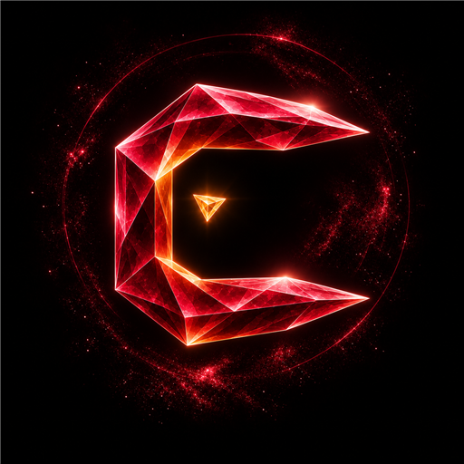
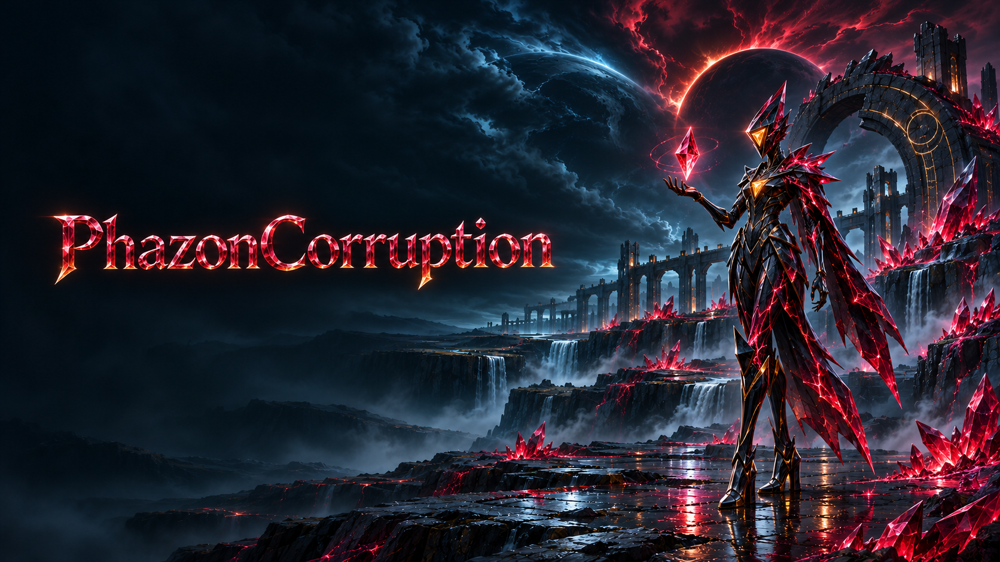

  

<h1 align="center">PhazonCorruption</h1>

  <strong>Metroid Prime 3: Corruption on PlayStation 5</strong> 
  An unofficial native PS5 homebrew port by <a href="https://github.com/BaZZtian">BaZZtian</a>.

  <a href="#availability">Availability</a> · <a href="#requirements">Requirements</a> · <a href="#support">Support</a>

## Availability

**Coming soon. No public PS5 download is available yet.** The PS5 download will be listed through [Prospero Store](https://prosperostore.net/) when available. You can follow the [store listing request](https://github.com/darkxex/ps5-homebrew-catalog/pull/1314).

## Requirements

PhazonCorruption is intended for PS5 homebrew users with their own copy of the Wii game. The first planned disc profile is Europe (PAL), RM3P01 revision 0. Supported formats and installation instructions will accompany the release. You will need your own copy of the Wii game. Firmware and loader requirements will be documented with the release.

## Support

For questions about PhazonCorruption, use [GitHub Issues](https://github.com/BaZZtian/PhazonCorruption/issues). See also [PhazonPrime](https://github.com/BaZZtian/PhazonPrime) for the first Metroid Prime.

## Credits and licenses

PhazonCorruption is maintained by BaZZtian. Its porting foundation is [bonllavier’s static recompilation project](https://github.com/bonllavier/metroprime3staticrecomp), which publishes its own code under GPL-3.0. Metroid Prime 3: Corruption was developed by Retro Studios and published by Nintendo.
